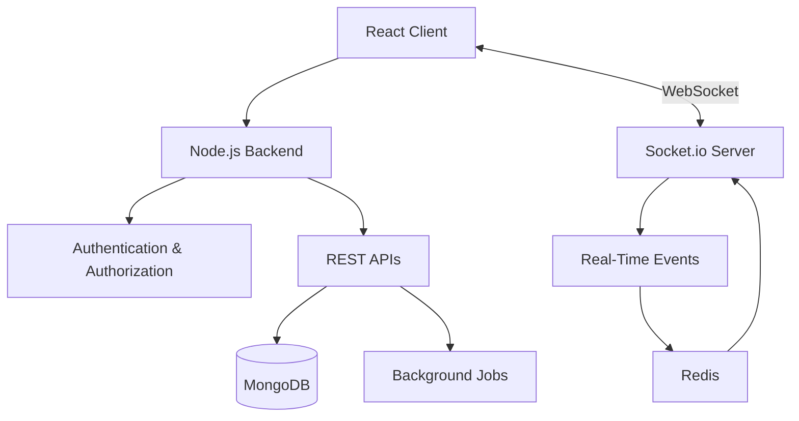

# Hi 👋, I'm Surya Prakash Singh

### Backend Engineer | Backend-Heavy Full Stack Developer | Building Distributed Scalable Systems

  

I'm a **Backend-focused Full Stack Developer** passionate about building scalable backend systems, distributed applications and real-time experiences.

I primarily work with **Node.js, TypeScript, NestJS, React, PostgreSQL and MongoDB**, with hands-on experience designing APIs, integrating third-party services and building production-grade applications.

- 💻 Backend-heavy Full Stack Engineer
- 🏗️ Experienced in designing and building systems from scratch
- ⚡ Built real-time messaging systems supporting 2,500+ concurrent users
- 🦷 Developed healthcare and payment workflows handling 25K+ monthly appointments
- 🔌 Experienced with REST APIs, WebSockets, Redis and microservices
- ☁️ Worked with AWS, Docker and CI/CD pipelines
- 🤖 Exploring AI engineering, LLMs and RAG applications
- 🌱 Continuously learning system design and distributed systems

📫 **Reach me:** [Email](mailto:suryaprakashsingh110@gmail.com)

---

## 🚀 Professional Highlights

| Area | Experience & Impact |
|---|---|
| Healthcare Systems | Developed Cashless Dental workflows supporting 25K+ monthly appointments |
| Real-Time Systems | Built messaging infrastructure supporting 2,500+ concurrent users |
| API Integrations | Integrated payment, insurance, fitness and third-party partner APIs |
| Notifications | Built centralized Email, WhatsApp and Push Notification workflows |
| Backend Engineering | Designed REST APIs, payment workflows and asynchronous processes |
| Frontend Engineering | Built production features using React.js and TypeScript |

---

## ⭐ Featured Projects

### 1. Real-Time Messaging Platform

**Tech Stack:** Node.js, React, Socket.io, MongoDB, WebSockets

Built a Slack/Zulip-inspired real-time communication platform with support for:

- Direct messaging and group conversations
- Channel-based communication
- Role-based access control and permissions
- Typing indicators and read/unread tracking
- Polls and interactive messaging
- Google Meet integration
- Real-time event delivery

**Impact:** Built a real-time messaging platform supporting 2,500+ concurrent users.

[View Repository](https://github.com/suryathink/chat-backend)

### 2. AI-Powered Image Generator

**Tech Stack:** MERN Stack, OpenAI API, React, Node.js, MongoDB

A full-stack AI application that generates images using AI APIs.

- Integrated OpenAI APIs for image generation
- Built REST APIs for image generation workflows
- Implemented pagination and infinite scrolling
- Developed responsive frontend interfaces

[View Repository](https://github.com/suryathink/AI-Image-Generator)

### 3. AI-Powered Knowledge Base / RAG Application

**Tech Stack:** Node.js, TypeScript, OpenAI, LangChain, Qdrant

Exploring Retrieval-Augmented Generation to build context-aware AI applications.

- PDF document ingestion and processing
- Text chunking and embedding generation
- Vector database integration
- Semantic search and context retrieval
- LLM-powered question answering

[View Repository](https://github.com/suryathink/ai-customer-support-web-app)

---

## 🏗️ System Architecture & Engineering

I enjoy understanding how systems work internally and making architectural decisions around scalability, reliability and maintainability.

### Real-Time Messaging Architecture

The following illustrates a high-level architecture for a real-time messaging system.

### Backend Engineering Concepts

- REST API design and versioning
- Authentication and authorization
- Database indexing and query optimization
- Caching strategies with Redis
- Event-driven architecture
- Message queues and asynchronous processing
- Microservices architecture
- Idempotency and fault tolerance
- Transactional Outbox Pattern
- CQRS and Event Sourcing

---

## 🛠️ Tech Stack

### Languages

  
  
  

### Backend & APIs

  
  
  
  
  

### Frontend

  
  
  
  
  

### Databases & Messaging

  
  
  
  
  

### Cloud, DevOps & Tools

  
  
  
  
  
  

---

## 📚 Currently Exploring

- Distributed Systems and System Design
- Microservices Architecture
- Kafka and RabbitMQ
- Transactional Outbox Pattern
- CQRS and Event Sourcing
- Database Internals and Optimization
- AI Engineering, LLMs and RAG
- Scalable Backend Architecture

---

## 📊 GitHub Statistics

  

  

  

  

---

## 🌐 Let's Connect

  
  
  

  <b>Building things that scale. Learning things that matter. 🚀</b>

